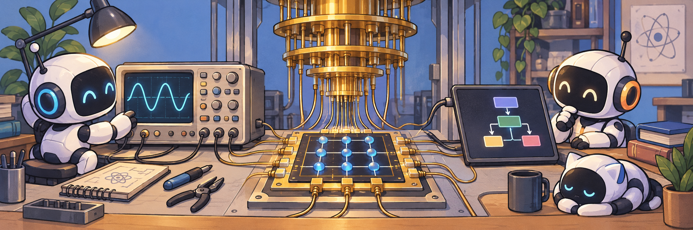
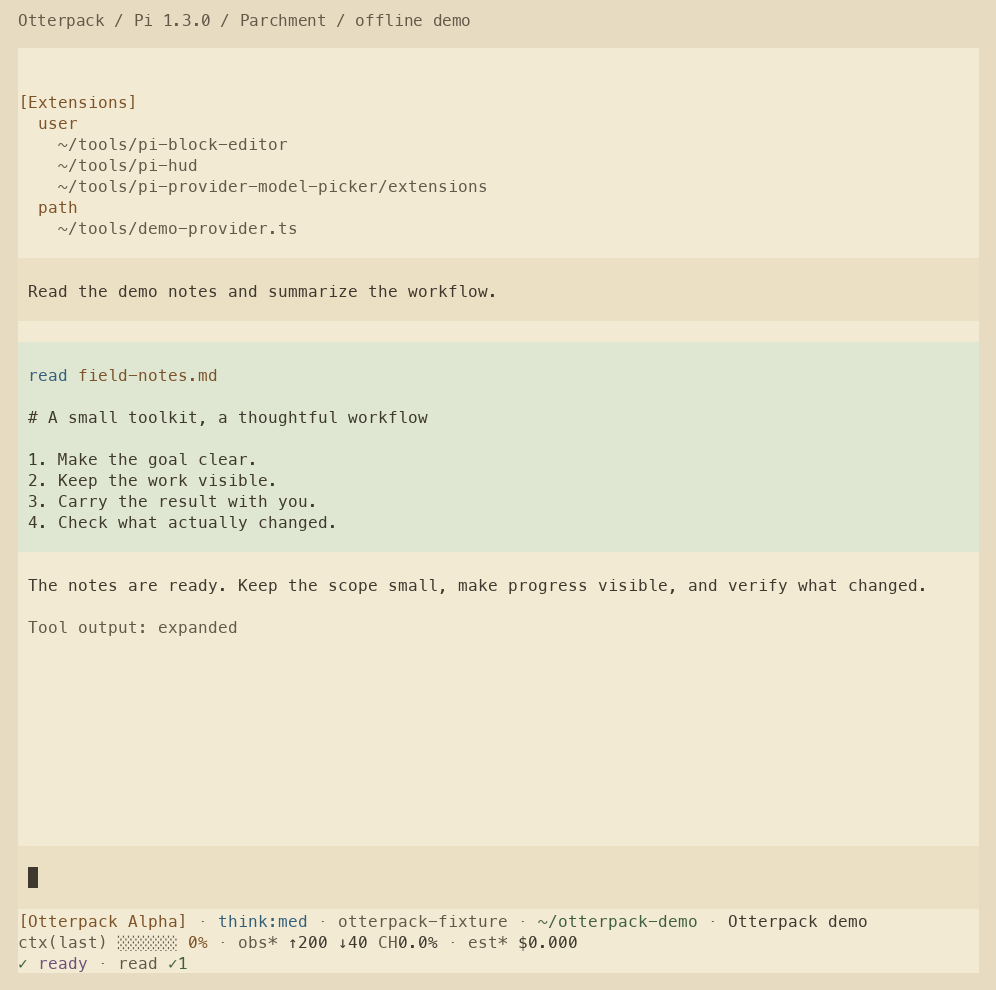
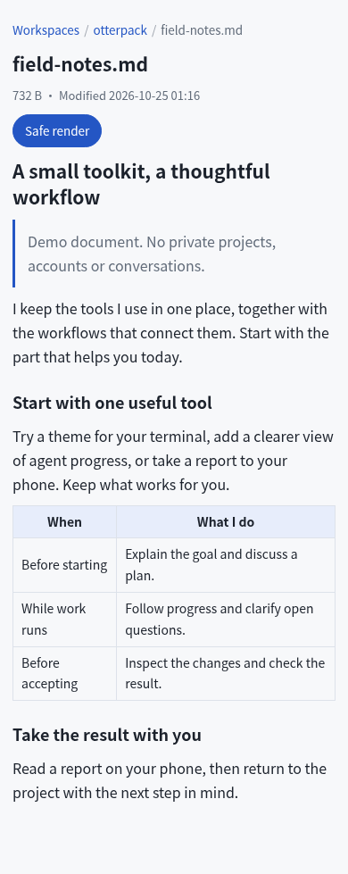

**Software engineer · AI agent tooling · Quantum measurement & control**

# Hi, I'm Han-Qing 👋

**I build tools for everyday work with AI coding agents.**

I'm a software engineer based in China. My projects help you choose skills for a project, see what an agent is doing, and take its results with you. My background is in **quantum measurement and control**, from chip topology to calibration workflows.

## Start with Otterpack 🦦

**[Otterpack](https://github.com/M1racleShih/otterpack)** brings together the tools, themes and workflows I use day to day. It includes my own tools, community adaptations and third-party projects, with their sources and licenses documented.

[Find a starting point](https://github.com/M1racleShih/otterpack/blob/main/docs/start.md) · [Browse the tools](https://github.com/M1racleShih/otterpack/blob/main/docs/catalogue.md) · [See the workflows](https://github.com/M1racleShih/otterpack/blob/main/docs/workflows.md)

## Selected projects

- **[dynamic-skills](https://github.com/M1racleShih/dynamic-skills)** — Keep a shared skill library; choose and pin the skills each project needs. Built for Codex, Claude Code, Kimi Code and Pi. [Install](https://github.com/M1racleShih/dynamic-skills#install) · PyPI, Alpha.
- **[conv-docs](https://github.com/M1racleShih/conv-docs)** — Read selected workspace documents on your phone, with token authentication, temporary previews and exclusion rules. [Deployment guide](https://github.com/M1racleShih/conv-docs/blob/main/docs/en/deploy.html).
- **[pi-hud](https://github.com/M1racleShih/pi-hud)** — See your model, context snapshots, tool activity and usage in Pi's terminal. Full-session accounting and provider quota queries are optional. [Local install](https://github.com/M1racleShih/pi-hud#install).
- **[cd-connect](https://github.com/M1racleShih/cd-connect)** — Hand a scoped task to DeepSeek Harness Desktop, then inspect its execution and results before accepting the work. [Quick start](https://github.com/M1racleShih/cd-connect#快速开始).
- **[QArray](https://github.com/M1racleShih/quantum-array)** — Represent quantum-chip qubits and couplers as arrays; work with rows, columns and regions of a chip. [Examples](https://github.com/M1racleShih/quantum-array#quick-start).

Also building **[Qingniao](https://github.com/M1racleShih/qingniao)**, a local model gateway for choosing routes independently across Claude Code instances. The core is runnable; there is no public registry release yet.

## From terminal to phone

  
  

Pi 1.3.0 with Otterpack's theme and plugins, and conv-docs on mobile. English interfaces with demo content.

<!-- Terminal image: M1racleShih/otterpack, commit 8cec63b0b7dfdadbea4634c956cbd261f7885c92, assets/pi-workflow.png, copied unchanged. English mobile image: real browser screenshot of M1racleShih/conv-docs at commit f987134dfd598bc494b45c849cd590fb4b7a563a, using an English demo document. -->

## Upstream contributions

Selected merged fixes:

- **[cc-connect](https://github.com/chenhg5/cc-connect/pull/1842)** — made skill discovery follow the selected workspace, use Codex's enabled catalog, and find Pi's project skills.
- **[herdr-remote](https://github.com/dcolinmorgan/herdr-remote/pull/104)** — added Codex conversation-history reading so sessions can be reviewed from the remote client.
- **[NextAI Translator](https://github.com/nextai-translator/nextai-translator/pull/1901)** — restored the missing Quit action in the Linux tray menu.

## Learning & research

- **[OpenAI Agents SDK Learning Lab](https://github.com/M1racleShih/openai-agents-sdk-learning-lab)** — a hands-on path from a first agent to a bounded, observable terminal application.
- **[Learn QEC](https://github.com/M1racleShih/learn-qec)** — learning quantum error correction, surface codes and lattice surgery in public.

I start with reproducible problems, keep changes reviewable, and check behavior at real agent-host and provider boundaries. Tests, recovery behavior and documentation are part of the work.

**Python · Rust · TypeScript**

For questions or feedback, open an issue in the relevant repository. I'm happy to talk about agent tooling, quantum chip topology and QEC learning.
